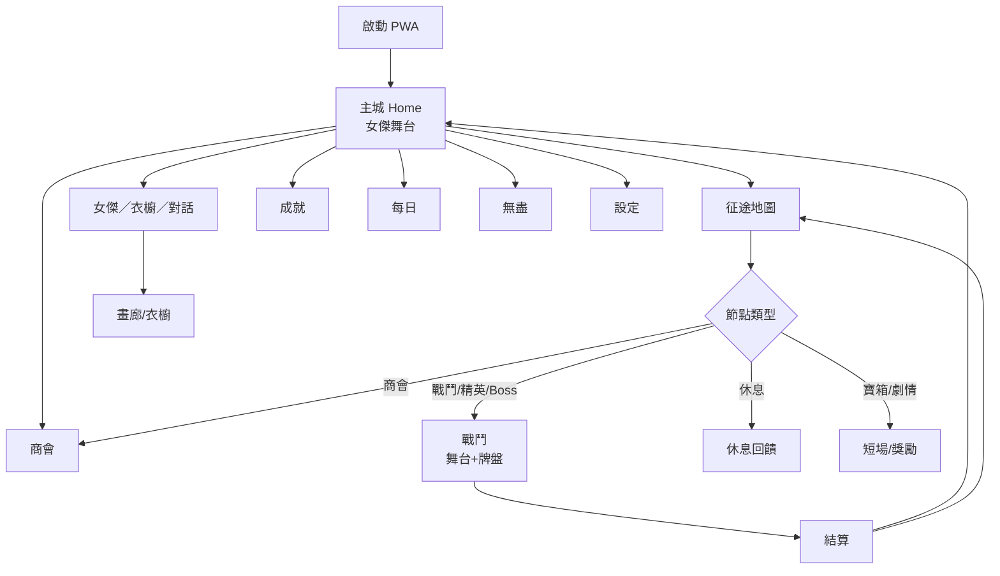

# 記憶帝國・女傑翻牌 — 整體規劃書（DESIGN_BIBLE）

> **狀態：【提案｜待使用者審核】**  
> 版本：Proposal v0.1 · 日期：2026-11-01（Asia/Taipei）  
> Live：https://tylerg2g.github.io/memory-empire/ · Repo：TYLERG2G/memory-empire  
> 對照：`GAME_DESIGN.md`（現行實作真相來源）· `me-ui-redesign/spec-claude.md`（UI 重做）· `me-anim-research/`（立繪 2D 動畫，不重複）  
> **審核通過前：請勿把本文件當施工令全面開幹新系統；UI worker 僅採納 `REFERENCE_ADDENDUM.md` 中與現行規格相容的項目。**

---

## 0. 一句話定位

精品獨立風 **記憶翻牌 RPG + 輕量女傑羈絆**，帝國 noir 氣質；主循環是「選路 → 翻牌戰鬥舞台 → 成長／衣櫥／對話」，在 iOS 主畫面 PWA 上要有現代手遊的質感，而不是網頁小遊戲。

**內容邊界（硬規則）**：原創成年角色；典雅／禮服／鎧甲／浴衣／夏日長洋裝／節慶裝 OK。**禁止**裸露、內衣、泳裝、性化姿勢、以皮膚為賣點的解鎖。

---

## 1. 為什麼現在不像現代遊戲（問題陳述）

| 症狀 | 根因 | 對標解法 |
|------|------|----------|
| 介面弱、像工具頁 | emoji icon、單層漸層、女傑被擠成配角 | 明日方舟／BA／R1999：立繪＝背景；自畫 SVG；毛玻璃＋暗金 |
| 戰鬥只有翻牌 | 缺「角色在打怪」的演出層 | Puzzle Quest／Pad：配對→攻擊演出 |
| 地圖像清單 | `#scr-map` 列表無路徑決策 | StS 節點圖＋手作章節風景 |
| 女傑互動薄 | 好感／禮物有，衣櫥與職業未產品化 | BA Cafe＋衣櫥＋職業徽章 |
| Juice 不足 | 配對回饋弱、toast 疊加 | Balatro 分層回饋＋佇列 |

---

## 2. 參考遊戲一覽（借什麼）

| 遊戲 | 借什麼 | 連結 |
|------|--------|------|
| **HYKE: Northern Light(s)【主】** | 立繪×像素雙軌、職業手感差、營地喘息循環、區域主題；反面：UI 摩擦、混戰 | https://hyke-northernlights.com/en/ · App Store id6479881755 |
| **Balatro** | 分層 juice（牌動／數字滾／微震／粒子／音階）；色即語意；回饋＝產品 | https://www.playbalatro.com/ · https://blakecrosley.com/guides/design/balatro |
| **Slay the Spire** | 節點地圖、風險路徑、Boss 前休息、意圖可讀 | https://www.megacrit.com/ · https://teemo.dev/game-design/slay-the-spire/systems/map-path-and-act-structure/ |
| **Inscryption** | 桌面儀式感、暗色光影、代價感（勿抄恐怖過激） | https://www.danielmullinsgames.com/ |
| **Cultist Simulator** | 典雅文案節奏、計時容器感（每日／體力隱喻） | https://weatherfactory.biz/cultist-simulator/ |
| **Luck be a Landlord** | 符號聯動、小單位大回饋 | https://store.steampowered.com/app/1404850 |
| **Card Shark** | 作弊／記憶主題的敘事包裝 | https://www.cardshark.game/ |
| **Signalis** | 克制 HUD、diegetic 介面、掃描線克制用 | 評價／分析文可參考 PC Gamer / Substack |
| **Blue Archive** | Cafe 點按互動、禮物偏好、MomoTalk 羈絆故事解鎖 | https://bluearchive.fandom.com/wiki/Cafe · Affection |
| **Arknights** | Home：Assistant 全螢幕＋右側功能列；動態立繪可關以省電 | https://arknights.wiki.gg/wiki/Home_Screen |
| **Reverse:1999** | Lobby 氣質、點立繪加絆、明體字世界觀、郵件物化 | 社群分析／官方 |
| **Honkai: Star Rail** | 手機訊息式輕對話（可作未來「帝國傳訊」） | 官方 |
| **Persona 5** | 限制色盤、視線引導線、轉場當標點、UI＝身份 | https://personacentral.com/persona-5-panel-concept-development-ui/ |
| **Coffee Talk / VA-11 Hall-A** | 溫暖對話節奏、吧檯式親密但不色情 | GDC / GameDeveloper UX 文 |
| **Puzzle Quest** | 消除／配對驅動 RPG 傷害與法術 | https://strategywiki.org/wiki/Puzzle_Quest:_Challenge_of_the_Warlords/Gameplay |
| **Puzzle & Dragons** | 盤面上方角色／敵人舞台、連擊爆發 | 官方 |
| **Dicey Dungeons / Loop Hero** | 像素角色可讀剪影、回合／循環節奏 | Steam |
| **Kingdom Rush** | 固定路徑節點的可讀性（地圖視覺） | 關卡幾何分析文 |
| **Octopath** | 章＝人物視角；多線章節結構靈感 | 官方 |
| **X／indie** | Hitstop＋閃白＋微震堆疊才有「打中」感 | https://x.com/Ludo_AI/status/2116187620732538916 |

**HuniePop 類**：只分析「三消／配對 → 好感進度」的 **gameplay loop**，**不**採成人內容、服裝暴露或約會性化。

---

## 2A. 【主要參考】HYKE: Northern Light(s)（使用者指定）

> App Store（TW）：https://apps.apple.com/tw/app/hyke-northern-light-s/id6479881755  
> 官網：https://hyke-northernlights.com/en/  
> Steam：https://store.steampowered.com/app/2680380/HYKENorthern_Lights/  
> 預告：https://www.youtube.com/watch?v=GZ2ZccmFIqQ  
> 評論：RPGFan https://www.rpgfan.com/review/hyke-northern-lights/（總分 73；肯定立繪／職業差異／Boss，批評戰鬥鬆散、營地圖重複、敘事薄）  
> 類型：2D 俯視動作像素 RPG · 開發 Akatsuki Games／Blast Edge · 發行 Aniplex · Apple Arcade／Steam／Switch／PS5 · 繁中 · 13+  
> 內部截圖參考：`/workspace/me-refs/hyke/`（勿上傳侵權素材進正式 repo）

### 為什麼它是「我們要長成的感覺」

HYKE 把 **精緻角色立繪／人設**、**戰鬥中的像素角色可讀剪影**、**大世界冒險節奏**、以及 **營地＝喘息與養成空間** 綁在同一套產品語言裡。這正是使用者抱怨「不像現代遊戲／女角沒互動感」時，最接近的對標（且服裝路線是魔女旅人／裝備，不是暴露向）。

### 分項借鏡（可執行）

| 面向 | HYKE 做法 | 我們怎麼借（守邊界） |
|------|-----------|----------------------|
| **UI 風格** | 玩家回饋「初期 UI 難用」、食譜要翻指南；營地圖空間擠 | **反面教材**：資訊層級要一眼掃（資源列／技能／地圖節點）；衣櫥與食譜式系統要「已擁有進度」內嵌，不要逼玩家跳手冊 |
| **美術方向** | 像素場景＋高完成度角色設定稿（orie）；點繪 Setamo/Shiros；懷舊／頹廢旅人氣質 | 帝國 noir 用 **立繪精品 + 戰鬥像素** 雙軌（RPGFan 也提醒兩者要對齊顔，避免立繪與點繪脫節） |
| **角色呈現** | 七名可切換魔女，操作手感差很大；區域 Boss→入隊 | 我們五女傑＝五職業（§7）；出征切換要有 **職業手感差異**（攻擊幀／技能／大招），不是換皮 |
| **戰鬥演出** | 俯視動作、技能 CD、連段；易混亂與數值不平衡 | **不抄動作操作**；抄「角色在場上打、技能改變節奏」。翻牌成功＝攻擊演出；失誤＝受擊。保持 Puzzle Quest 式因果清楚，避免 HYKE 被批的「失控混戰」 |
| **進度／循環** | 選關→破霧探索→寶箱→回營裝飾／料理 buff→再出擊；全球分數挑戰 | 對應：地圖節點→戰鬥→結算→主城／「帝國休憩」（禮物／對話／衣櫥）→每日／無盡。料理 buff 可對標「出征前小整备」（茶／烤肉禮物的戰鬥小加成，P2） |
| **地圖** | 領域分關、戰霧、重複地塊被批 | 用手作章節風景＋節點 DAG，**少重複貼圖**；每章視覺主題強烈（已有五章文案） |
| **造型／裝備** | 營地整理裝備、佈置；角色外觀差異大 | 衣櫥系統（§6）：立繪＋戰鬥像素同步；裝備感走披風／鎧甲／禮服，**禁止**泳裝內衣路線 |
| **音場** | 營地 BGM 可選、主題曲 Silhouette | 主城／營地可切 BGM 情緒；戰鬥與結算分層 duck（現行 audio.js 可擴） |
| **雙人／友情技** | 1.1 標籤隊、友情技能 | P2 支援位光環可對標，非優先 |

### 明確不借

- 俯視即時動作操作與大量同屏敵群（手機 PWA 與翻牌主軸衝突，且易「混亂」）。  
- 薄人設＋短營地對話就結束——我們反而要 **加厚** 羈絆文案（MomoTalk／傳訊可作載體）。  
- 任何性化或清涼解鎖（HYKE 本身也非此路線；我們守則更嚴）。


---

## 3. 核心循環（提案）

```text
登入／主城（女傑立繪舞台）
  → 征途地圖選節點
  → 戰鬥：翻牌盤 + 像素舞台演出
  → 結算（金幣／星／好感／掉落）
  → 可選：商會／衣櫥／對話／每日／無盡
  → 回主城（時間問候、紅點）
```

**無課金留存（提案）**：每日挑戰、體力回復節奏、好感日互動上限、章節風景解鎖、成就、本地無盡排行——延續現行經濟，不引入 IAP。

---

## 4. 世界地圖設計（提案）

### 4.1 章節＝區域

沿用現行 5 章 × 10 關，但視覺升級為 **區域地圖**：

| 章 | 名 | 區域視覺 | Boss（現行） |
|----|----|----------|--------------|
| 1 | 緋月序曲 | 帝都外環夜景、哨塔熄燈 | 霧影斥候／外環守門人 |
| 2 | 鏡廳迷宮 | 舊王宮鏡廊、碎反射 | 鏡中侍從／千面女官 |
| 3 | 星祭長街 | 港都燈籠夜市 | 燈籠商人／星祭司儀 |
| 4 | 霜原要塞 | 北境雪道、符文牆 | 霜鎧衛士／冰冠將軍 |
| 5 | 帝冠終章 | 王座之間穹頂 | 影之宰相／虛冠之主 |

### 4.2 節點類型（借 StS，手作固定圖）

| 類型 | 圖示語意 | 行為 |
|------|----------|------|
| 戰鬥 | 劍／牌 | 一般關 |
| 精英 | 雙劍／紫焰 | 較難、較好獎勵（可對應現行較高 stage） |
| Boss | 紅金冠 | 每 5 關；全章終點 |
| 休息 | 營火 | 回復 1 體力或小幅加時 buff（新） |
| 商會 | 秤 | 進入商店子集 |
| 寶箱 | 箱 | 金幣／信物 |
| 劇情 | 捲軸 | 播章節／羈絆短場 |

**路徑結構（提案）**：每章一張 **固定手作 DAG**（非完整 StS 程序生成，以利敘事與 PWA 體積）。玩家從入口向下／向上推進；主線必經 10 個主節點；支線 2–4 個可選。Boss 前建議強制或推薦「休息」。參考 StS：開場溫和、中段寶箱錨點、Boss 前喘息。

### 4.3 視覺風格

羊皮捲軸底、暗金路徑線、已通關 `check`、鎖定鎖、目前位置脈衝。章切換有斜線轉場（Persona 氣味，但色盤仍是帝國紅金，不是 P5 純紅白黑）。

---

## 5. 戰鬥演出（提案｜像素舞台）

### 5.1 版面

```text
┌─────────────────────────────┐
│  [女傑 chibi]  FX  [怪物]   │  ← .battle-stage 88–120px（UI 已要求預留）
│         怪 HP 條             │
├─────────────────────────────┤
│  分數／時間條／連擊／技能    │
├─────────────────────────────┤
│         撲克翻牌盤           │
└─────────────────────────────┘
```

### 5.2 規則映射（Puzzle Quest 精神）

| 玩家行為 | 舞台演出 |
|----------|----------|
| 配對成功 | 女傑播放攻擊幀 → 命中 FX → 傷害數字 → 怪 HP 下降 |
| 連擊上升 | 攻擊加成或額外段數；≥3 微震＋粒子 |
| 釋放技能 | 職業演出（見 §7） |
| 連擊達閾／能量滿 | 大招（Ultimate）全螢幕斜線＋高傷害 |
| 失誤 | 女傑受擊閃白；怪攻擊動畫；扣「壁壘」或時間（與現行 missLimit／時間對齊） |
| 時間危急 | 怪蓄力演出；超時＝敗北或大傷害 |

**勝敗**：以「清空怪 HP」為主表現；底層仍可用「配對完盤＋星級」作真相，舞台 HP 為演出層（第一版可讓怪 HP＝剩餘配對數×係數，避免兩套數值分裂）。

### 5.3 像素素材來源與授權

| 來源 | 授權 | 注意 |
|------|------|------|
| OpenGameArt Tiny Creatures（Kenney 風格擴充） | CC0 | https://opengameart.org/content/tiny-creatures |
| itch「Beasts」等標 CC0 的 RPG 角色包 | CC0 | 逐包核 LICENSE |
| Pixel Monsters Megapack 等 CC0 | CC0 | 若含 AI 生成需產品內披露政策自定 |
| 自製 Aseprite | 自有 | **女傑 chibi 建議最終自製**以統一顔 |
| AI 輔助像素 | 視工具條款 | 必須人手修齊、對齊調色盤；遵守內容邊界 |

**Loop Hero／Dicey Dungeons**：借可讀剪影與有限幀動畫（idle／attack／hit／death），不要堆特效到手機發熱。

---

## 6. 造型／衣櫥系統（提案）

### 6.1 原則

每位女傑多套造型；**同一套造型同時切換**：

1. 主城／畫廊 **立繪**（CSS class／WebP 變體）  
2. 戰鬥 **像素 chibi** 色盤／配件層  

### 6.2 現行資料（已有）

`OUTFITS`：`default` 常服、`cape` 夜宴披風（好感 2）、`formal` 帝國禮服（好感 4）、`summer` 夏日洋裝（商店）、`yukata` 祭典浴衣（第三章）。

### 6.3 解鎖途徑（擴充提案）

| 途徑 | 例 |
|------|----|
| 好感里程碑 | cape／formal |
| 章節／劇情 | yukata←Ch3；鎧甲←Ch4 等 |
| 成就 | 「七日修行」解鎖節慶小物 |
| 商店金幣 | summer 等 |
| （可選）無盡里程 | 特殊披風 |

### 6.4 數值？

**預設：造型以外觀為主（cosmetic）**。若要給「小小差異」，僅限：

- ±5% 某職業相關表現（如禮服：對話好感＋1；戰鎧：攻擊演出傷害係數＋5%）  
- **不可**做成付費逼買或暴露誘惑。

### 6.5 衣櫥 UI

女傑頁橫滑 `.outfit-rail`：鎖定／已有／裝備中。預覽同時顯示立繪框＋迷你 chibi。文案與縮圖必須典雅。

### 6.6 允許／禁止清單

- **允許**：常服、軍禮服、披風、帝國禮服、長裙夏日洋裝、浴衣、戰鬥鎧甲、斗篷、節慶正裝、學者袍。  
- **禁止**：泳裝、內衣、浴毛巾、破衣、強調裸露面積的「清涼」解鎖。

---

## 7. 職業系統（提案）

每位女傑＝**一種職業**；職業決定：攻擊演出風格、技能、大招、（可選）編隊光環。

### 7.1 花名冊對照（對應 `js/data.js`）

| id | 姓名 | 現行 title | 現行 skill | **職業** | 攻擊風格 | 技能（戰場表述） | 大招構想 |
|----|------|------------|------------|----------|----------|------------------|----------|
| verda | 薇爾妲·諾克特 | 冷傲魔女軍官 | peek 魔眼窺視 | **魔女（Mage）** | 遠程魔彈／紫焰 | 短暫揭示牌面 | 全場預覽／對怪魔力爆發 |
| karena | 卡蓮娜·緋焰 | 熱血機甲騎士 | freeze 緋焰停滯 | **機甲先鋒（Vanguard）** | 衝撞近戰多段 | 短暫凍結倒數／時間 | 時間停滯斬 |
| elys | 艾莉絲·羅亞 | 優雅外交官 | time 從容斡旋 | **調停祭司（Diplomat／Support）** | 光環彈、優雅斬擊 | 加時／緩傷 | 全體緩衝＋大加時 |
| selas | 塞拉斯·薇恩 | 冷酷參謀官 | match 戰術推演 | **戰術刺客（Tactician）** | 快速刺擊 | 自動促成一對／標記 | 連續刺殺多段 |
| reina | 萊娜·克洛斯 | 忠誠騎士團長 | combo 騎士誓約 | **聖騎士（Paladin）** | 劍光橫掃 | 連擊倍率強化 | 誓約聖光終結一擊 |

### 7.2 編隊／協同（P2）

第一版 **單出征女傑**（現行）。P2 可：支援位提供被動（如出征 Reina、支援 Elys → 開場＋2 秒）。避免複雜到像完整戰棋。

---

## 8. 功能總表與優先級

圖例：✅ 已有（可強化）· 🔧 部分 · ❌ 新 · 審＝待審核後做

| 功能 | 狀態 | 優先 | 說明 |
|------|------|------|------|
| 主城／立繪互動 | 🔧 | P0 | UI 重做中；動畫見 anim research |
| 自畫 SVG UI | 🔧 | P0 | icons／玻璃／Dock |
| Toast 佇列 | ❌ | P0 | 修疊加 |
| 征途列表地圖 | ✅ | P0→P1 | P1 升節點圖 |
| 節點世界地圖 | ❌ | P1 | §4 |
| 翻牌戰鬥核心 | ✅ | P0 | 保；加 juice |
| 像素戰鬥舞台 | ❌ | P1 | §5；UI 先留位 |
| 怪 HP／攻擊演出 | ❌ | P1 | |
| 女傑名冊／解鎖 | ✅ | P0 | 加職業徽章 |
| 好感／禮物／對話 | 🔧 | P0–P1 | 文案 Argon 拋光 |
| 衣櫥完整化 | 🔧 | P1 | §6 |
| 職業演出差異 | 🔧 | P1 | skill 已有，加舞台 |
| 商店 | ✅ | P0 | icon 化 |
| 成就 | 🔧 | P0 | CSS bug 修 |
| 每日／無盡 | ✅ | P0 | |
| 畫廊／CG | 🔧 | P1 | |
| 設定／PWA | ✅ | P0 | |
| 存檔遷移 | ✅ | P0 | memoryRPG_v3 |
| 音效／BGM | ✅ | P0 | 舞台 SFX 擴 |
| 編隊協同 | ❌ | P2 | |
| 帝國傳訊（HSR 風） | ❌ | P2 | |
| 3D／進階 Live2D | ❌ | P2–P3 | 見 anim research |
| IAP／廣告 | ❌ | — | **不做**（本提案） |

---

## 9. 畫面流（提案）



現行 DOM id 盡量保留：`scr-home|map|battle|result|roster|shop|ach|settings`。

---

## 10. UI／美術方向（摘要）

- 色：帝國暗紅 `#12060b` 底＋暗金 `#e8c26a`；連擊金、危險紅、資源琥珀。  
- 字：Noto Serif TC 標題／Noto Sans TC 內文。  
- 材質：毛玻璃、雙線金邊、按鈕 bevel 下沉。  
- Icon：inline SVG sprite，禁 emoji。  
- 詳見 `me-ui-redesign/spec-claude.md` 與 `REFERENCE_ADDENDUM.md`。

---

## 11. Motion／Juice 指南（摘要）

1. 每個關鍵操作至少 2 層回饋（視＋聽；重要再加震）。  
2. 配對成功必須「看得見因果」（牌→傷害數字）。  
3. Hitstop 80–130ms＋微震優於狂加粒子。  
4. 轉場用切／斜線；避免長淡出。  
5. Toast 單列佇列。  
6. 尊重減少動態效果系統設定（P1）。

---

## 12. 分階段路線圖（提案）

| 階段 | 內容 | 預估 |
|------|------|------|
| **Now** | UI 重做 P0、toast、成就樣式、戰鬥 HUD、**battle-stage 佔位** | 進行中 |
| **Phase A** | 文案拋光、衣櫥 rail、職業徽章、翻牌 juice | 審核後 |
| **Phase B** | 節點地圖、像素女傑／怪、配對→攻擊管線 | 審核後 |
| **Phase C** | 大招、休息／寶箱節點、編隊被動、傳訊 | 後期 |
| **Phase D** | 進階立繪動畫（見 anim research）、可選 3D | 更後期 |

---

## 13. 模型意見分歧（本回合）

| 主題 | 傾向 A | 傾向 B | 提案裁定 |
|------|--------|--------|----------|
| 地圖生成 | StS 全程序生成 | 手作固定章圖 | **手作 DAG**（敘事＋體積） |
| 造型數值 | 純 cosmetic | 小幅加成 | **預設 cosmetic**；小幅可選開關 |
| 戰鬥真相 | 雙數值（牌＋HP） | HP 綁剩餘配對 | **第一版綁配對**，減少分裂 |
| 立繪技術 | Live2D | CSS／切層 | **交 anim research**；本文件不裁決 |
| UI 色盤 | 更偏 P5 紅白 | 帝國紅金 | **紅金**（與現行 UI 規格一致） |
| 像素密度 | HYKE 全像素世界 | 僅戰鬥舞台像素 | **雙軌**：大廳立繪精品、戰鬥／地圖節點像素（HYKE 精神） |


### Opus 批判摘要（2026-11-01，未改程式）

完整：`/workspace/me-design-research/opus-critique.md`。

- **建議**：先只合併 UI；Bible 再修成 v0.2 後審 Phase B。
- **最高風險**：像素 HP／連擊加成／大招／造型傷害係數會讓「HP 綁配對」名存實亡 → v0.2 必須寫死「演出層不得改變清盤條件」。
- **P1 過載**：節點圖＋像素管線＋衣櫥美術量需拆里程碑與負責人。
- **地圖**：DAG 與現行線性 `maxStage`／`stars[n]` 不相容 → 需存檔遷移或第一版「視覺節點、邏輯仍線性」。
- **衣櫥**：現行多為 CSS 濾鏡，非真換裝 WebP；勿低估美術。
- **舞台高度**：小螢幕需可折疊／預覽期靜止，避免搶記牌注意力。

Flash 研究摘要：`/workspace/me-design-research/flash-summary.md`。Claude UI 規格已採納為實作底。Argon 動畫／UI 並行中，細節以各 worker 產出為準。

---


---

## 15. 開源美術與遊戲設計資源（精選）

> 原則：優先 **CC0 / MIT / OFL / CC-BY**；避開 **CC-BY-NC、全 GPL 傳染進發佈包**（引擎可 MIT）。整合前再核一次來源頁。  
> 本機暫存（未進遊戲）：`/workspace/me-refs/oss/` + `LICENSE_NOTES.md`。  
> 現有：`js/vendor/pixelfx`（MIT）、`assets/sfx`（CC0）。

| # | 資源 | 授權 | 給我們什麼 | Vanilla JS PWA 適配 |
|---|------|------|------------|---------------------|
| 1 | [Kenney UI Pack](https://kenney.nl/assets/ui-pack) / [OGA](https://opengameart.org/content/ui-pack) | CC0 | 面板、按鈕、字型／UI 音 | 僅參考；正式 UI 用自畫 SVG |
| 2 | [Kenney Pixel UI](https://opengameart.org/content/pixel-ui-pack-750-assets) | CC0 | 像素面板／條／游標 | 戰鬥 HUD／地圖節點框可裁 |
| 3 | [Kenney UI RPG Extension](https://opengameart.org/content/ui-pack-rpg-extension) | CC0 | 奇幻 RPG UI 元件 | 商會／寶箱 icon 靈感 |
| 4 | [Tiny Creatures](https://opengameart.org/content/tiny-creatures) | CC0 | 180 隻 16×16 怪／動物 | Boss／雜兵剪影佔位 |
| 5 | [Kenney Tiny Battle](https://opengameart.org/content/tiny-battle) | CC0 | 單位／地形小戰鬥 | 舞台地板紋理 |
| 6 | [Beasts RPG pack](https://aklingon.itch.io/50-rpg-character-asset-pack) | CC0 | 50 角色×多動畫 | chibi 動作參考／臨時代替 |
| 7 | [Pixel Monsters Megapack](https://blacis.itch.io/pixel-monsters-mega-pack) | CC0 | 百隻怪＋Aseprite | 怪素材；注意 AI 披露 |
| 8 | [ark-pixel-font](https://github.com/TakWolf/ark-pixel-font) | MIT | **CJK 像素字** | 傷害數字／Boss 名；體積需子集 |
| 9 | [Departure Mono](https://github.com/rektdeckard/departure-mono) | OFL | 拉丁像素等寬 | HUD 英文／數字；無 CJK |
| 10 | [zpix](https://github.com/SolidZORO/zpix-pixel-font) | 見 repo | 中日英像素字 | **授權頁需再核**（GitHub license 欄空） |
| 11 | [pixelfx](https://github.com/patch-gg/pixelfx) | MIT | 像素 FX 小程式碼 | **已 vendor**；命中／冰／焰 |
| 12 | [Phaser](https://github.com/phaserjs/phaser) | MIT | 完整 HTML5 引擎 | **不整包引入**；可讀場景／tween 模式 |
| 13 | [PixiJS](https://github.com/pixijs/pixijs) | MIT | WebGL 2D | 若上 Spine／大量 sprite 再評估；現階段 CSS 優先 |
| 14 | [awesome-cc0](https://github.com/madjin/awesome-cc0) | CC0 目錄 | CC0 總索引 | 搜尋入口 |
| 15 | [Free-Game-Dev-Assets](https://github.com/TMHSDigital/Free-Game-Dev-Assets) | 目錄 CC0 | **逐條核過授權**的目錄 | 首選索引 |
| 16 | [Calinou/awesome-gamedev](https://github.com/Calinou/awesome-gamedev) | 目錄 | 自由軟體／自由文化工具 | 工具鏈 |
| 17 | [superpowers-asset-packs](https://github.com/sparklinlabs/superpowers-asset-packs) | CC0 | Pixel-boy 角色／場景包 | 像素旅人參考 |
| 18 | [jsfxr](https://sfxr.me/) / jsfxr libs | Unlicense 常見 | 程序音效 | 補舞台 SFX |
| 19 | [game-icons.net](https://game-icons.net/) | CC-BY | SVG 圖示海量 | 需署名；我們自畫優先 |
| 20 | [GDD template (MIT)](https://github.com/kosinaz/game-design-document-template-for-beginners) | MIT | 設計書結構範本 | 本 DESIGN_BIBLE 對照 |
| 21 | [mixandjam Balatro-feel](https://github.com/mixandjam/balatro-feel) | 見 repo | 牌懸浮／選取手感研究 | 翻牌 juice 參考（勿抄資產） |
| 22 | itch CC0 搜尋 | 各包不同 | 角色／FX／UI | **逐包讀 LICENSE** |
| 23 | [Lucide Icons](https://lucide.dev/) | ISC | 線條 icon | 非遊戲風；可對照線寬 |
| 24 | 本專案 `assets/sfx` | CC0 | 既有音效 | 續用 |
| 25 | Ansimuz SunnyLand 等 | 多為 CC0 | 平台像素包 | 氛圍參考，非主視覺 |

**架構學習（不要整包依賴）**：讀 Phaser 的場景狀態機、Pixi 的 ticker／sprite 池、pixelfx 的「一效果一段小碼」——維持 vanilla 模組邊界（`MODULE_CONTRACT.md`）。

**紅線**：CC-BY-NC 不可進商業／公開發佈假設；GPL 素材勿鏈進主包；AI 素材包需產品披露政策。


## 14. 請使用者確認的問題

1. 是否同意 **配對→像素攻擊舞台** 作為戰鬥升級主軸？  
2. 地圖要 **手作節點圖** 還是更接近 StS 的隨機塔？  
3. 造型要 **純外觀** 還是允許 ±5% 小加成？  
4. 五職業命名／對照表是否 OK（§7.1）？  
5. Phase B 之前是否先只合併 UI 重做上線？

---

*本文件為規劃提案，不取代 `GAME_DESIGN.md` 直至審核通過並遷入實作條款。*
